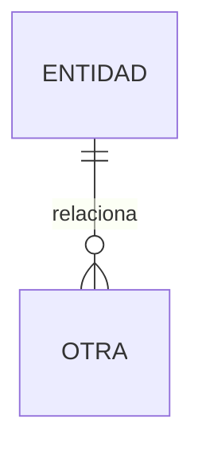

# Diseño de datos

## Control

- Versión:
- Estado: preliminar | vigente
- Motor: relacional | documental | mixto | pendiente
- Insumo: SRS vigente

## 1. Decisiones de persistencia

Qué se guarda, qué no, y por qué este motor. Si el repositorio ya tiene motor, partir de ahí.

## 2. Modelo conceptual

Entidades o agregados, atributos esenciales y relaciones, en lenguaje del dominio.

## 3. Modelo lógico

Relacional: tablas, claves, cardinalidad, unicidad, restricciones e integridad.
Documental: colecciones o contenedores, claves, documentos embebidos o referenciados, y validaciones.

## 4. Modelo físico

Índices y su consulta. Particiones o réplicas solo si el perfil o el SRS lo piden.
Política de borrado lógico o físico, retención y auditoría cuando aplique.

## 5. Diagrama

Sustituir el ejemplo por el modelo real. Borrar el ejemplo.

## 6. Diccionario

| Nombre | Tipo | Obligatorio | Regla | Requisito |
|---|---|---|---|---|

Si esta tabla supera el documento, continuar en `DATA_DICTIONARY.md` junto a este archivo.

## 7. Migraciones

Estrategia de versiones, reversibilidad y compatibilidad. No pegar una migración ejecutable como si ya se hubiera aplicado.

## 8. Acceso y protección

Privilegios mínimos, datos sensibles y copias de seguridad si el perfil lo exige.

## 9. Contratos

Cómo se relaciona este modelo con los DTO o recursos de la API. Huecos marcados como PENDIENTE.

## 10. Pendientes

Decisiones que el SAD no debe dar por cerradas.
